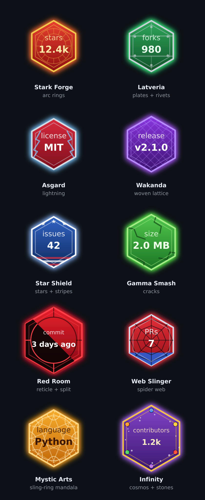

# hex-badges

Hexagonal badges on Vercel. Two styles: `wide` (default) and `single`.

    /api/badge?style=wide&label=build&message=passing&color=brightgreen
    /api/badge?style=single&label=stars&message=12.4k&color=blue
    /badge/wide/build/passing/brightgreen        (path form)

Params: style, label, message, color, labelColor (wide only). Colors: names or hex.

Deploy: `npm i -g vercel && vercel`

## Preview

### Live examples

| Theme | Single hexagon | Elongated |
|---|---|---|
| **Stark Forge** red + gold `theme=stark-forge` |  |  |
| **Latveria** green + silver `theme=latveria` |  |  |
| **Asgard** red + silver `theme=asgard` |  |  |
| **Wakanda** black + purple `theme=wakanda` |  |  |
| **Star Shield** blue + red + white `theme=star-shield` |  |  |
| **Gamma Smash** green + purple `theme=gamma` |  |  |
| **Red Room** black + red `theme=red-room` |  |  |
| **Web Slinger** red + blue + black `theme=web-slinger` |  |  |
| **Mystic Arts** amber + crimson `theme=mystic-arts` |  |  |
| **Infinity** purple + gold `theme=infinity` |  |  |

Use any of them with your own data, for example:

    
    

## GitHub badges

    /github/<metric>/<owner>/<repo>
    /github/stars/facebook/react
    /github/last-commit/facebook/react?style=wide

| Metric | Shows |
|---|---|
| stars, forks, watchers | counts |
| issues, prs | open issues / open pull requests |
| release | latest release (falls back to latest tag) |
| tag | latest tag |
| last-commit | relative time, optional `branch` |
| license | SPDX id |
| contributors | count (includes anonymous) |
| language | primary language |
| size | repository size |

Params: `style` (`single` default, or `wide`), `label`, `color`, `labelColor` (wide only).
Set `GITHUB_TOKEN` in Vercel env vars to avoid the 60 req/hour unauthenticated limit.

## Avengers themes

Add `?theme=<name>` to any badge. Single hexagons get a glow and a themed pattern; use `?pattern=none` to turn the pattern off.

| Theme | Colors | Single-hex pattern |
|---|---|---|
| stark-forge | red + gold | arc-reactor rings |
| latveria | green + silver | armor plates + rivets |
| asgard | red + silver | lightning |
| wakanda | black + purple | woven lattice |
| star-shield | blue + red + white | stars + stripes |
| gamma | green + purple | cracks |
| red-room | black + red | reticle + split |
| web-slinger | red + blue + black | spider web |
| mystic-arts | amber + crimson | sling-ring mandala |
| infinity | purple + gold | cosmos + stones |

    /github/stars/facebook/react?theme=stark-forge
    /github/stars/facebook/react?theme=web-slinger&style=wide

The glow looks best on dark backgrounds. Preview sheet: `node scripts/patterns-sheet.js out.svg`.

## Landing page

`public/index.html` is served at `/`: a badge builder with copy buttons and a gallery of all themes.
